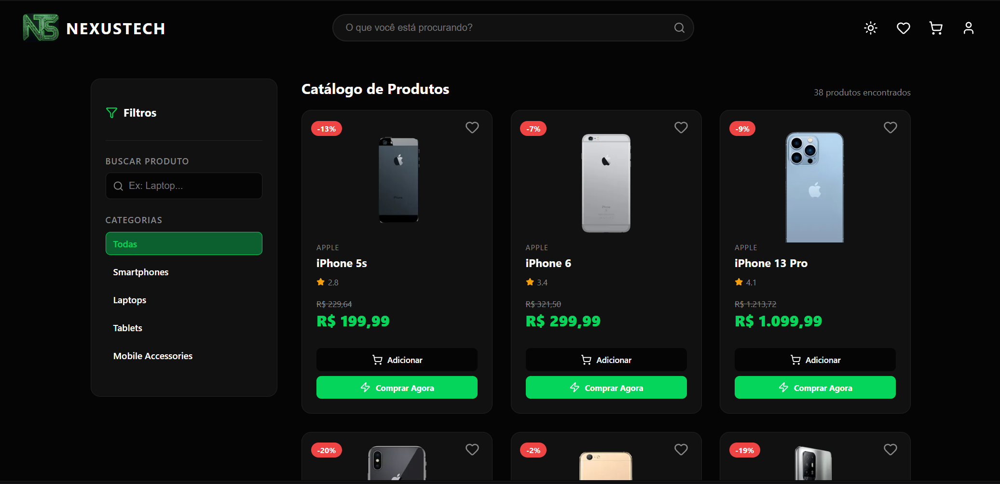
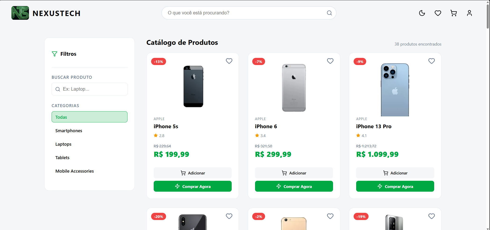
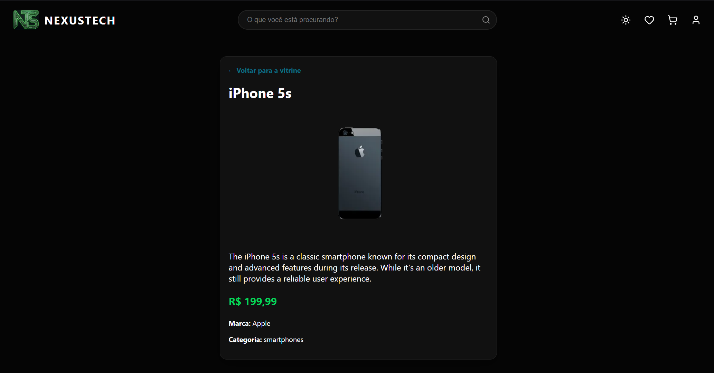
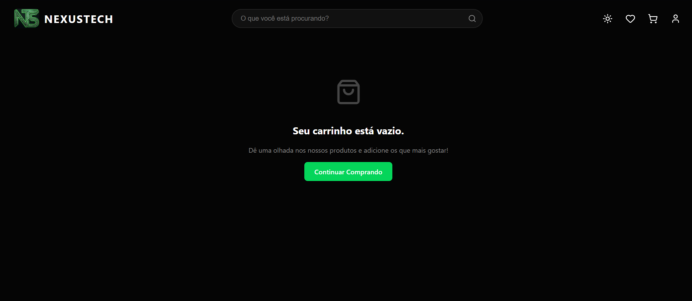
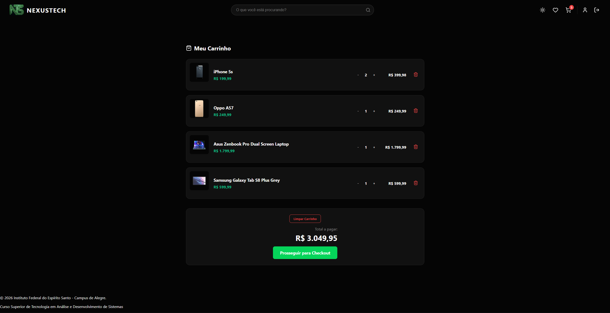
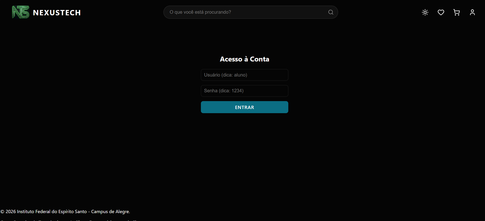
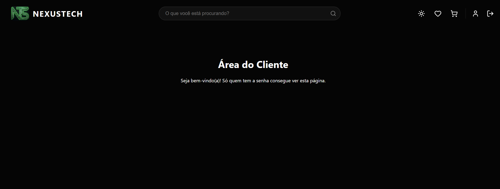

# 🚀 NexusTech Store - Projeto Integrador

## 🌐 Deploy

✨ **Veja o projeto em funcionamento:** [Acessar Demonstração (Vercel)](https://tads-store-gccavalcante.vercel.app/)

---

## 📝 Descrição

O **NexusTech Store** é uma Single Page Application (SPA) de e-commerce focada em eletrônicos e hardware de alta performance. Desenvolvido como requisito avaliativo para o **Projeto Integrador do curso de Tecnologia em Análise e Desenvolvimento de Sistemas (TADS — IFES Campus de Alegre)**, o sistema simula um ambiente real de compras online, utilizando **React 19**, **React Router v7**, **Context API** e integrando dados dinâmicos de serviços externos (**DummyJSON** e **ViaCEP**), com um Design System próprio documentado em [`DESIGN.md`](./DESIGN.md).

---

## ✨ Funcionalidades Implementadas

### 📦 1. Consumo de API Externa e Filtros (Vitrine)
- Conexão em tempo real com a **API DummyJSON**, realizando buscas paralelas via `Promise.all` exclusivamente em categorias tecnológicas (`smartphones`, `laptops`, `tablets`, `mobile-accessories`).
- Categorias traduzidas para português (`Celulares`, `Notebooks`, `Tablets`, `Acessórios`) com contadores de produtos por categoria (barra lateral no desktop e seletor horizontal em chips no mobile).
- Tratamento explícito de estados de **Carregando (Skeleton de 8 cards sem salto de layout)**, **Vazio** e **Erro** na interface.
- Sistema duplo de busca: pesquisa global via cabeçalho (utilizando `useSearchParams` do React Router) e filtros locais por texto e categoria na barra lateral.

### 🔍 2. Página de Detalhes do Produto (`/produto/:id`)
- Layout editorial assimétrico (`7/5`) com *breadcrumb* de navegação.
- Galeria interativa de fotos com troca de miniatura a partir de `produto.images[]`.
- Exibição de disponibilidade e alerta de estoque baixo (`< 10` unidades), preço tabular, percentual de desconto, tabela de especificações técnicas (`Marca`, `Categoria`, `Envio`, `Garantia`, `Devolução` e `SKU`) e seção de **Avaliações reais** (`reviews[]`).
- Ações dedicadas de **Adicionar ao carrinho**, **Comprar agora** e **Favoritar**.

### 🛒 3. Gerenciamento de Carrinho e Favoritos
- Adição de produtos ao carrinho com confirmação visual imediata (`✓`) no card e incremento automático de quantidade para itens duplicados.
- Layout do carrinho em duas colunas com controle acessível de quantidade (`-` / `+`), exclusão individual, confirmação inline antes de esvaziar o carrinho e resumo lateral fixo (*sticky*) com cálculo em tempo real.
- Blindagem e normalização automática de dados persistidos no `localStorage` (`CarrinhoContext` e `FavoritosContext`) contra estruturas legadas ou corrompidas.

### 📍 4. Integração de Serviços no Checkout (`/checkout`)
- Integração com a **API ViaCEP** na tela de finalização de compra.
- Ao digitar um CEP válido de 8 dígitos (com máscara automática `00000-000`), o sistema realiza uma requisição assíncrona, preenchendo os campos de Rua, Bairro, Cidade e UF automaticamente.
- Rótulos (`<label>`) visíveis em todos os campos, distinção visual para campos `readOnly`, tratamento de erros inline (sem `alert()`) e resumo lateral do pedido sincronizado com o carrinho.

### 🔐 5. Autenticação e Proteção de Rotas
- Sistema de login com persistência de sessão utilizando `localStorage` (`AuthContext`).
- Componente `RotaPrivada.jsx` que intercepta acessos não autorizados à Área do Cliente (`/minha-conta`) e redireciona o usuário para a tela de autenticação (`/login`).

### 🎨 6. Design System e Reestruturação Visual (`ui-humanizer`)
As decisões visuais e tokens estão documentados em [`DESIGN.md`](./DESIGN.md):
- **Paleta e Contraste (WCAG):** Superfícies neutras puxadas para o verde-circuito da marca (`--surface-0/1/2`), acento `--accent: #05d55a` reservado à ação principal da tela e texto escuro `--on-accent: #04150b` sobre botões verdes (elevando o contraste de `~2,0:1` para `~10:1`).
- **Tema Escuro e Claro:** Suporte completo a **Dark Mode** e **Light Mode** via variáveis CSS (`body.light-mode`), incluindo cabeçalho fixo (`sticky`) consistente nos dois temas.
- **Tipografia Técnica:** Par tipográfico **IBM Plex Sans** (interface e leitura) + **IBM Plex Mono** (`tabular-nums` em preços, quantidades, contadores e SKUs) em escala modular de razão `1.2`.
- **Remoção de Ruído Visual:** Substituição de estilos inline, *glassmorphism*, brilhos neon, elevação exagerada de cards no hover, `transition: all` e regras `!important` por classes semânticas e transições rápidas (`120ms`) com suporte a `prefers-reduced-motion`.

---

## 🗂️ Estrutura de Pastas

```text
tads-store/
├── public/                  # Logos e ativos estáticos
├── prints/                  # Capturas de tela do projeto
├── src/
│   ├── components/
│   │   ├── BotaoFavorito.jsx  # Toggle de favorito acessível (aria-pressed)
│   │   ├── Cabecalho.jsx      # Header sticky, busca global, tema e navegação
│   │   ├── Layout.jsx         # Estrutura base (Cabecalho + main + Rodape)
│   │   ├── ProdutoCard.jsx    # Card de produto com link esticado e ação rápida
│   │   ├── Rodape.jsx         # Créditos institucionais IFES
│   │   ├── RotaPrivada.jsx    # Guard de rota autenticada
│   │   └── Vitrine.jsx        # Catálogo, filtros, busca e skeleton
│   ├── contexts/
│   │   ├── AuthContext.jsx      # Estado de sessão (logado, entrar, sair)
│   │   ├── CarrinhoContext.jsx  # Carrinho, quantidades, totais e normalização
│   │   └── FavoritosContext.jsx # Lista de favoritos persistida
│   ├── pages/
│   │   ├── Home.jsx           # Página inicial (Vitrine)
│   │   ├── Detalhe.jsx        # Página de produto com galeria, specs e reviews
│   │   ├── Carrinho.jsx       # Gestão de itens e resumo de compra
│   │   ├── Checkout.jsx       # Endereço (ViaCEP), pagamento e resumo do pedido
│   │   ├── Favoritos.jsx      # Grade de produtos salvos
│   │   ├── Login.jsx          # Formulário de acesso à conta
│   │   ├── MinhaConta.jsx     # Área restrita do cliente
│   │   └── NaoEncontrado.jsx  # Página 404
│   ├── utils/
│   │   └── formatacao.js      # Formatação BRL, tradução de categorias e limiares
│   ├── App.css                # Design tokens, base, componentes e responsividade
│   ├── App.jsx                # Definição de rotas
│   ├── index.css              # Reset mínimo global
│   └── main.jsx               # Ponto de entrada e Providers
├── DESIGN.md                # Documentação do Design System e decisões visuais
└── vite.config.js           # Configuração Vite com suporte dual-stack IPv4/IPv6
```

---

## 🚀 Como Executar o Projeto

Certifique-se de possuir o [Node.js](https://nodejs.org/) instalado em seu ambiente local.

1. **Clone o repositório para sua máquina:**
   ```bash
   git clone https://github.com/gccavalcante/tads-store
   ```
2. **Acesse o diretório do projeto:**
   ```bash
   cd tads-store
   ```
3. **Instale todas as dependências necessárias:**
   ```bash
   npm install
   ```
4. **Inicie o servidor de desenvolvimento local:**
   ```bash
   npm run dev
   ```
5. **Acesse no navegador:** `http://localhost:5173`

### 🔑 Usuário de Teste (Login)
- **Usuário:** `aluno`
- **Senha:** `1234`

---

## 📸 Galeria do Projeto
Abaixo, confira algumas das principais telas da **NexusTech Store**:

| Vitrine de Produtos |
| :---: |
|  |
|  |

| Detalhes do Produto |
| :---: |
|  |

| Carrinho de Compras |
| :---: |
|  |
|  |

| Área de Acesso (Login) |
| :---: |
|  |

| *Área restrita* |
| :---: |
|  |
